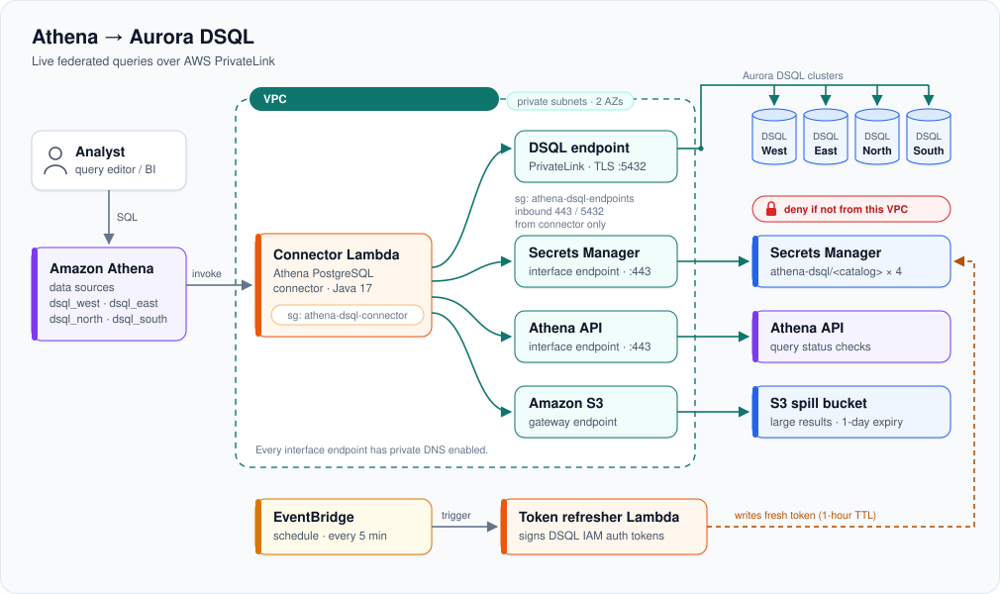

# Solo Traveler Data Engineering Project

## Table of Contents

- [Overview](#overview)
- [Tech Stack](#tech-stack)
- [Architecture](#architecture)
- [Project Structure](#project-structure)
- [Data Sources](#data-sources)
- [Getting Started](#getting-started)
- [Setup](#setup)
- [Athena/Aurora DSQL Connector](#athenaaurora-dsql-connector)
- [CI/CD Pipeline](#cicd-pipeline)

## Overview

An AWS data pipeline that finds the cheapest last-minute vacations for a solo traveler flying out of Phoenix. It pulls travel data from four sources (flights, hotels, destination activities and exchange rates), stores the raw data, transforms it and loads it into a database where it can be queried by dashboards.

Queryable datasets are grouped by region based on each destination's latitude and longitude. Destinations in the United States and Canada are grouped into West or East regions, while destinations in Mexico are grouped into North or South regions.

### How it works

- **Flights:** Starting from Phoenix, the pipeline finds the 30 cheapest flight destinations in the US, Canada and Mexico.
- **Hotels:** For each destination extracted in the raw flight data, it pulls room rates for 18 hotel properties.
- **Destination activities:** For each destination, the Geoapify API finds activities within a set radius of the city, such as artwork, museums, viewpoints, cultural entertainment, heritage sites, outdoor activities, beaches, national parks and skiing.
- **Exchange rates:** The pipeline pulls the latest USD → Mexican peso and USD → Canadian dollar rates on the day the data is extracted. Rates are only attached to international destinations.

### What you get

The transformed data is loaded into the gold layer in Amazon Aurora Serverless and queried with Athena. For each trip, it shows:

- Which vacations depart in 7 days.
- Which destinations are cheapest, based on a round-trip flight from Phoenix plus a week-long hotel stay.
- The activities available at each destination and its vacation type.
- The exchange rate, for international destinations.

## Tech Stack

- Amazon EventBridge
- AWS Step Functions
- Amazon API Gateway
- AWS Lambda
- AWS Glue PySpark Scripts
- AWS Glue Data Catalog
- AWS Glue Data Quality
- Amazon S3 (bronze and silver layer)
- Amazon Aurora Serverless (gold layer)
- Amazon Athena
- Amazon Quick Sight
- GitHub Actions (CI/CD)

## Architecture

The pipeline follows the medallion architecture.
Data moves through 3 layers, each one cleaner and more query-ready than the last.

| Layer      | What it holds                                                                                          | Format  |
| ---------- | ------------------------------------------------------------------------------------------------------ | ------- |
| **Bronze** | Raw API responses, exactly as returned (one S3 bucket per source)                                      | JSON    |
| **Silver** | Each source cleaned & standardized on its own (one S3 bucket per source + one combined S3 data bucket) | Parquet |
| **Gold**   | Sources are grouped by region into four analytics-ready datasets (four Aurora Serverless clusters)     | Parquet |

Every layer is partitioned by `extract_date=YYYY-MM-DD/`.


1. **EventBridge** runs a daily schedule that starts the Step Functions workflow allowing the full ETL pipeline to run every morning.
2. **API Gateway** exposes REST API endpoints to start the pipeline.
3. **Step Functions** orchestrates the ETL workflow.
4. **Extract → Bronze** The extract Lambdas call each API and write the raw JSON responses to the bronze S3 buckets. The lambda functions are coordinated to run in parallel.
   - Exchange rates run on their own.
   - Airplane ticket rates, hotel room rates and destination activities run in a chain. The hotels Lambda searches the destinations from the flight deals data and the destination activities Lambda searches the destinations data from the hotels.
5. **Transform → Silver** One transform Lambda per source reads its bronze JSON, keeps only the fields the pipeline needs, cleans all the data and writes the result as Parquet to that source's silver bucket.
   - Exchange rates
   - Airplane ticket rates
   - Hotel room rates
   - Destination activities
6. **Catalog** Once extraction finishes, a Glue Crawler crawls the bronze S3 buckets, infers each source's schema and registers it as a table (with its `extract_date` partitions) in the Glue Data Catalog, so the raw data can be discovered and queried before it is transformed.
7. **Final Transform → Silver** A final AWS Glue job script joins the four silver datasets into one combined Parquet dataset. Instead of pointing at the S3 buckets and inferring schemas from the files on every run, the script reads each dataset through its table in the Glue Data Catalog.
8. **Catalog** Once the final transform Glue job script joins the datasets and sets it into it's S3 bucket within the silver layer, a Glue Crawler crawls the final S3 bucket to infer its schema and register it as a table in the Glue Data Catalog.
9. **Load → Gold** A load Glue job script reads the combined Parquet dataset metadata from the Glue Data Catalog and writes it into the gold layer. The gold layer consists of four Amazon Aurora Serverless clusters. Each cluster corresponds to a specific region and datasets are grouped by region based on each destinations latitude and longitude. Destinations in the United States and Canada are grouped into West or East regions, while destinations in Mexico are grouped into North or South regions.
10. **Athena** queries the gold Parquet files in Amazon Aurora Serverless through the Glue Data Catalog.
11. **Amazon Quick Sight** visualizes the results.

## Project Structure

```
├── .github/
│   └── workflows/
│       ├── deploy-lambda.yaml                               # CI/CD for the Lambdas
│       └── deploy-glue.yaml                                 # CI/CD for the Glue job
├── docs/
│   └── images/
│       └── Data_Engineering_Diagram.svg                     # README.md Architecture Diagram
├── src/
│   ├── extract/                                             # API → bronze (raw JSON)
│   │   ├── extract_exchange_rates/
│   │   ├── extract_airplane_ticket_rates/
│   │   ├── extract_hotel_room_rates/
│   │   └── extract_destination_activities/
│   ├── transformation/                                      # bronze → silver (Parquet)
│   │   ├── transform_exchange_rates/
│   │   ├── transform_airplane_ticket_rates/
│   │   ├── transform_hotel_room_rates/
│   │   ├── transform_destination_activities/
│   │   └── transform_combine_airplane_hotel_destination_datasets/
│   └── load/
│       └── load_combined_dataset_aurora                     # silver → gold (Parquet)
├── tests/
│   ├── extract/                                             # one test file per extract Lambda
│   ├── transformation/                                      # one test file per transform Lambda
│   └── load/                                                # one test file per load Lambda
├── .gitignore
└── README.md
```

## Data Sources

| Data                    | Source                                                                                  |
| ----------------------- | --------------------------------------------------------------------------------------- |
| Currency exchange rates | [Free Currency API](https://freecurrencyapi.com/docs/)                                  |
| Flight costs            | [SerpApi – Google Flights API](https://serpapi.com/google-flights-api)                  |
| Hotel room costs        | [SerpApi – Google Hotels API](https://serpapi.com/google-hotels-api)                    |
| Destination activities  | [Geoapify – Travel & Tourism APIs](https://www.geoapify.com/industries/travel-tourism/) |

## Getting Started

### Prerequisites

To run the code and tests on your computer:

- [Git](https://git-scm.com/downloads)
- [Python 3.14](https://www.python.org/downloads/) and `pip`

To deploy and run the pipeline in AWS, you also need:

- An AWS account with permission to create Lambda, S3, Step Functions, EventBridge, API Gateway, Glue, Athena, Aurora Serverless, Secrets Manager and IAM resources.
- API keys listed in [setup](#setup).
- A GitHub fork of this repository.

### Local setup

1. **Clone the repository**

   ```bash
   git clone git@github.com:melgp7423/data-engineering-solo-traveler-portfolio-project.git
   cd data-engineering-solo-traveler-portfolio-project
   ```

2. **Create and activate a virtual environment**

   ```bash
   python3.14 -m venv .venv
   source .venv/bin/activate
   ```

3. **Install the dependencies** Each Lambda has its own `requirements.txt`. Install `pytest` plus the requirements of every Lambda:

   ```bash
   pip install pytest
   for req in src/*/*/requirements.txt; do pip install -r "$req"; done
   ```

4. **Run the tests** The tests import the Lambdas from `src/`, so set `PYTHONPATH`:

   ```bash
   PYTHONPATH=src pytest tests
   PYTHONPATH=src pytest tests/extract/test_extract_exchange_rates.py
   ```

5. **Create a `.env` file** in the project root.

## Setup

### CI/CD Pipeline key

| Category                   | Stored in                           | Repository secret     |
| -------------------------- | ----------------------------------- | --------------------- |
| AWS IAM Role OIDC Provider | `github actions repository secrets` | `AWS_DEPLOY_ROLE_ARN` |

### API keys

The extraction Lambdas need three API keys. The keys are stored in AWS Secrets Manager. Each Lambda has an environment variable that holds the name of its secret and the Lambda reads the key from Secrets Manager when it runs.

| API            | Used by                                                     | Lambda environment variable |
| -------------- | ----------------------------------------------------------- | --------------------------- |
| SerpApi        | `extract_airplane_ticket_rates`, `extract_hotel_room_rates` | `API_KEY_SECRET`            |
| Exchange Rates | `extract_exchange_rates`                                    | `ACCESS_KEY_SECRET`         |
| Geoapify       | `extract_destination_activities`                            | `API_KEY_SECRET`            |

### AWS ARN keys

The extraction, transformation and load Lambda functions use environment variables to reference the ARNs of the AWS S3 buckets and the Aurora cluster they read from and write to. These values are kept in a local .env file and set on each Lambda function's configuration in AWS, so account-specific resource identifiers aren't exposed.

| ENV Type           | Used by                                                                                                                                                          | Environment variable                                                 |
| ------------------ | ---------------------------------------------------------------------------------------------------------------------------------------------------------------- | -------------------------------------------------------------------- |
| Lambda ARN         | `deploy-lambda.yaml`                                                                                                                                             | `AWS_EXTRACT_EXCHANGE_RATES_ARN`                                     |
| Lambda ARN         | `deploy-lambda.yaml`                                                                                                                                             | `AWS_EXTRACT_AIRPLANE_TICKET_RATES_ARN`                              |
| Lambda ARN         | `deploy-lambda.yaml`                                                                                                                                             | `AWS_EXTRACT_HOTEL_ROOM_RATES_ARN`                                   |
| Lambda ARN         | `deploy-lambda.yaml`                                                                                                                                             | `AWS_EXTRACT_DESTINATION_ACTIVITIES_ARN`                             |
| Lambda ARN         | `deploy-lambda.yaml`                                                                                                                                             | `AWS_TRANSFORM_EXCHANGE_RATES_ARN`                                   |
| Lambda ARN         | `deploy-lambda.yaml`                                                                                                                                             | `AWS_TRANSFORM_AIRPLANE_TICKET_RATES_ARN`                            |
| Lambda ARN         | `deploy-lambda.yaml`                                                                                                                                             | `AWS_TRANSFORM_HOTEL_ROOM_RATES_ARN`                                 |
| Lambda ARN         | `deploy-lambda.yaml`                                                                                                                                             | `AWS_TRANSFORM_DESTINATION_ACTIVITIES_ARN`                           |
| Glue job name      | `deploy-glue.yaml`                                                                                                                                               | `AWS_TRANSFORM_COMBINE_AIRPLANE_HOTEL_DESTINATION_DATASETS_GLUE_JOB` |
| Lambda ARN         | `deploy-lambda.yaml`                                                                                                                                             | `AWS_LOAD_COMBINED_DATASET_AURORA_ARN`                               |
| S3 BUCKET ARN      | `extract_exchange_rates`,<br>`transform_exchange_rates`,<br>`transform_combine_airplane_hotel_destination_datasets`                                              | `AWS_EXCHANGE_RATES_S3_BUCKET`                                       |
| S3 BUCKET ARN      | `extract_airplane_ticket_rates`,<br>`extract_hotel_room_rates`,<br>`transform_airplane_ticket_rates`,<br>`transform_combine_airplane_hotel_destination_datasets` | `AWS_AIRPLANE_TICKET_RATES_S3_BUCKET`                                |
| S3 BUCKET ARN      | `extract_hotel_room_rates`,<br>`extract_destination_activities`,<br>`transform_hotel_room_rates`,<br>`transform_combine_airplane_hotel_destination_datasets`     | `AWS_HOTEL_ROOM_RATES_S3_BUCKET`                                     |
| S3 BUCKET ARN      | `extract_destination_activities`,<br>`transform_destination_activities`,<br>`transform_combine_airplane_hotel_destination_datasets`                              | `AWS_DESTINATION_ACTIVITIES_S3_BUCKET`                               |
| S3 BUCKET ARN      | `transform_combine_airplane_hotel_destination_datasets`,<br>`load_gold_layer`                                                                                    | `AWS_COMBINE_AIRPLANE_HOTEL_DESTINATION_TRANSFORMED_DATA_S3_BUCKET`  |
| AURORA CLUSTER ARN | `extract_airplane_ticket_rates`,<br>`extract_hotel_room_rates` REVIEW                                                                                            | `AWS_GOLD_LAYER_AURORA_SERVERLESS_CLUSTER`                           |

Each source keeps its raw (bronze) and transformed (silver) data in the same bucket, separated by folder prefixes set on each Lambda:

| Environment variable  | Used by                                    | Purpose                                                                               |
| --------------------- | ------------------------------------------ | ------------------------------------------------------------------------------------- |
| `RAW_PREFIX`          | every `extract_*` and `transform_*` Lambda | Folder above `extract_date=` for that source's raw JSON (`""` = bucket root)          |
| `TRANSFORMED_PREFIX`  | every `transform_*` Lambda                 | Folder above `extract_date=` for that source's Parquet output                         |
| `FLIGHT_DEALS_PREFIX` | `extract_hotel_room_rates`                 | Raw prefix of the airplane ticket rates data in `AWS_AIRPLANE_TICKET_RATES_S3_BUCKET` |
| `HOTEL_PREFIX`        | `extract_destination_activities`           | Raw prefix of the hotel room rates data in `AWS_HOTEL_ROOM_RATES_S3_BUCKET`           |

## Athena/Aurora DSQL Connector

Athena queries the four Aurora DSQL clusters live through a federated query connector. Everything is created by `setup-athena-dsql.sh` and is ran from AWS CloudShell. It deploys a CloudFormation stack called `athena-dsql` in a private mode with VPC endpoints and security groups.

The connector runs inside the VPC and uses only VPC endpoints via PrivateLink so traffic never crosses the internet and a cluster policy can reject any connection from outside the VPC.

### Architecture (private mode)



### Components

| Component                                                                                                        | What it does                                                                                                                                                                                                                                                                                                                                                                |
| ---------------------------------------------------------------------------------------------------------------- | --------------------------------------------------------------------------------------------------------------------------------------------------------------------------------------------------------------------------------------------------------------------------------------------------------------------------------------------------------------------------- |
| **Athena data sources** `dsql_west`, `dsql_east`, `dsql_north`, `dsql_south`                                     | Catalogs of type `LAMBDA` that point Athena at the connector. Pick one in the query editor's Data source dropdown.                                                                                                                                                                                                                                                          |
| **Connector Lambda** (`athena-dsql-ConnectorFunction-…`)                                                         | AWS's open-source Athena PostgreSQL connector (`PostGreSqlMuxCompositeHandler`, Java 17). DSQL speaks the PostgreSQL wire protocol, so the standard connector works. One function serves both catalogs via `dsql_west_connection_string` / `dsql_east_connection_string`. Needs `JAVA_TOOL_OPTIONS=--add-opens=java.base/java.nio=ALL-UNNAMED` for Apache Arrow on Java 17. |
| **Secrets** `athena-dsql/dsql_west`, `athena-dsql/dsql_east`, `athena-dsql/dsql_north`, `athena-dsql/dsql_south` | Hold `{"username":"admin","password":"<IAM token>"}` per cluster. The connector reads them at connect time (cached about 60 s).                                                                                                                                                                                                                                             |
| **Token refresher Lambda** + **EventBridge rule**                                                                | DSQL has no static passwords, only short-lived IAM auth tokens. Every 5 minutes this function generates a fresh `DbConnectAdmin` token that is valid 1 hour for each cluster's hostname and writes it into the secret.                                                                                                                                                      |
| **Spill bucket**                                                                                                 | Private, encrypted S3 bucket for result sets too large to return directly. Objects expire after 1 day.                                                                                                                                                                                                                                                                      |
| **Code bucket** `athena-dsql-code-<account>-<region>`                                                            | Holds the connector jar that Lambda loads.                                                                                                                                                                                                                                                                                                                                  |

### Private networking

| Resource                                               | Purpose                                                                                                                                                                                       |
| ------------------------------------------------------ | --------------------------------------------------------------------------------------------------------------------------------------------------------------------------------------------- |
| **Security group** `athena-dsql-connector`             | Attached to the connector Lambda. Outbound only; no inbound rules.                                                                                                                            |
| **Security group** `athena-dsql-endpoints`             | Attached to endpoints the script creates. Allows TCP 443 and 5432 **only from** `athena-dsql-connector`.                                                                                      |
| **DSQL interface endpoint**                            | Private connection to the clusters. The connector uses the PrivateLink hostname `<cluster-id>.<service-id>.<region>.on.aws`. The script adds the connector to this endpoint's security group. |
| **Secrets Manager** and **Athena** interface endpoints | Let the connector read secrets and check query status privately.                                                                                                                              |
| **S3 gateway endpoint**                                | Lets the connector write to the spill bucket privately.                                                                                                                                       |

There's no NAT gateway or internet route. Every interface endpoint must have private DNS enabled; the script checks this and stops if it's off.

### Request flow

1. A query runs in Athena against `dsql_west`, `dsql_east`, `dsql_north`, `dsql_south`.
2. Athena invokes the connector Lambda with the catalog name.
3. The connector reads that catalog's secret (through the Secrets Manager endpoint) and connects to the cluster's PrivateLink hostname on port 5432 (database `postgres`, `sslmode=require`), using the current token as the password.
4. DSQL checks the token's IAM signature and the cluster resource policy (connection must come from the VPC).
5. The connector reads metadata and rows, pushes filters down to DSQL where it can, and returns results to Athena, through the spill bucket for large results.

## CI/CD Pipeline

The Lambda functions and the Glue job are tested and deployed automatically with GitHub Actions through two separate workflows.

| Workflow                                                     | Deploys                                                              | Packaged as                   |
| ------------------------------------------------------------ | -------------------------------------------------------------------- | ----------------------------- |
| [`deploy-lambda.yaml`](.github/workflows/deploy-lambda.yaml) | Every `extract_*` and `transform_*` Lambda function                  | `.zip` uploaded to AWS Lambda |
| [`deploy-glue.yaml`](.github/workflows/deploy-glue.yaml)     | The `transform_combine_airplane_hotel_destination_datasets` Glue job | Python script uploaded to S3  |
| [`deploy-glue.yaml`](.github/workflows/deploy-glue.yaml)     | The `load_gold_layer` Glue job                                       | Python script uploaded to S3  |

### Lambda pipeline (`deploy-lambda.yaml`)

The Lambda workflow only tests and redeploys the Lambdas whose code or tests changed, so a change to one function never touches the others.

### Glue job pipeline (`deploy-glue.yaml`)

The `transform_combine_airplane_hotel_destination_datasets` and the `load_gold_layer` steps run as AWS Glue jobs so it has its own workflow.
